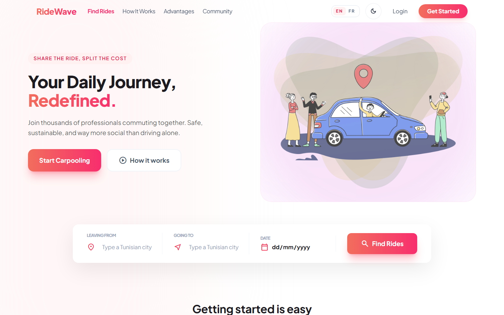
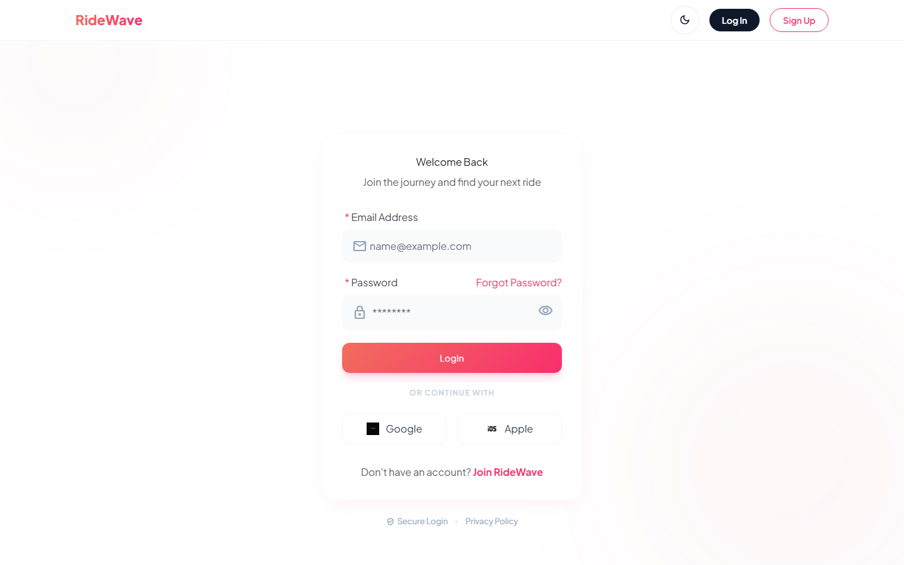
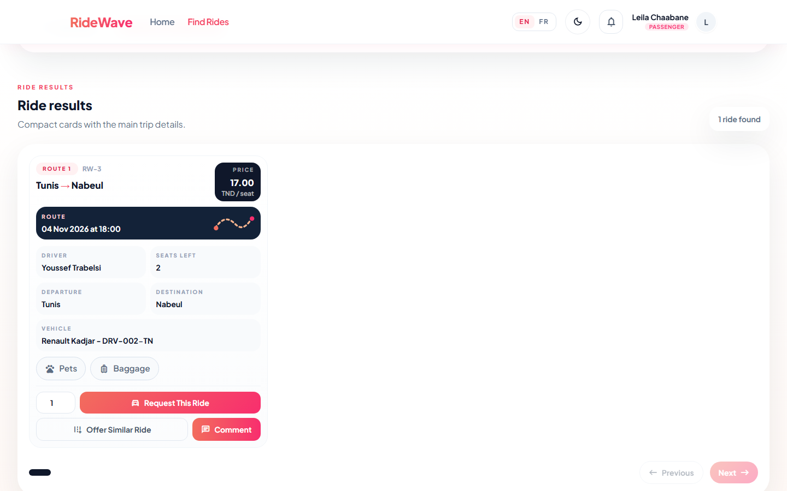
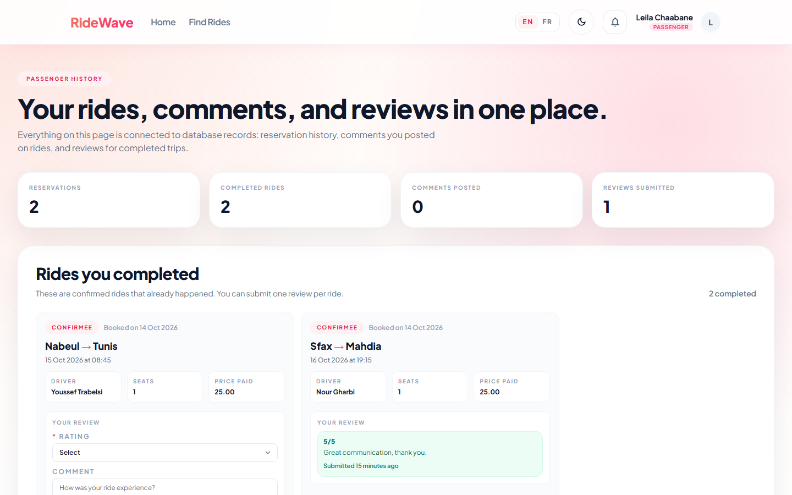
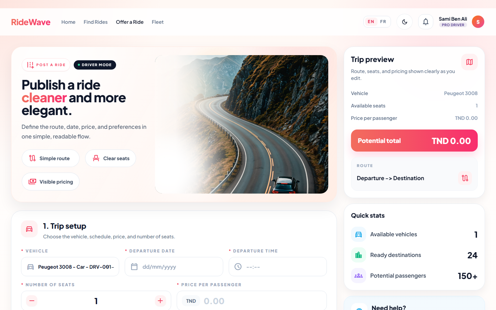
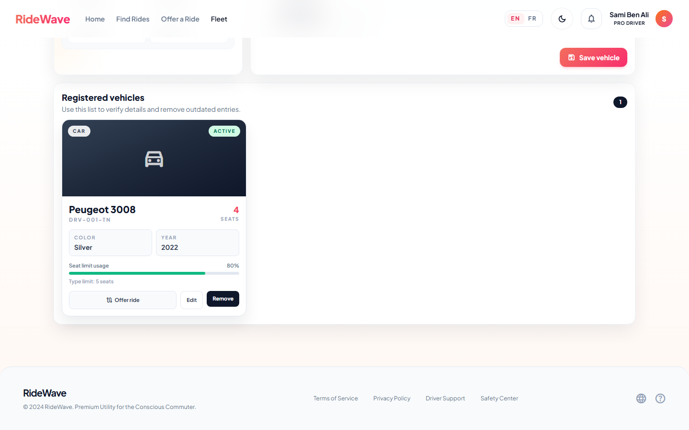
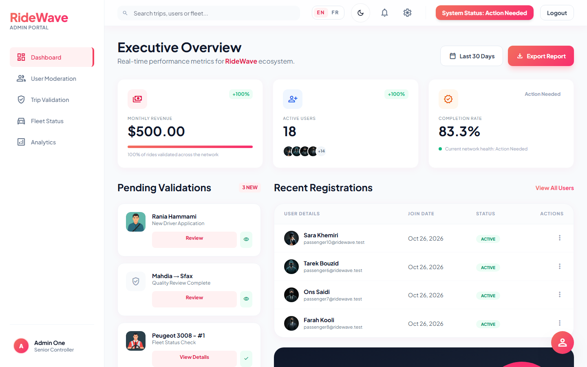
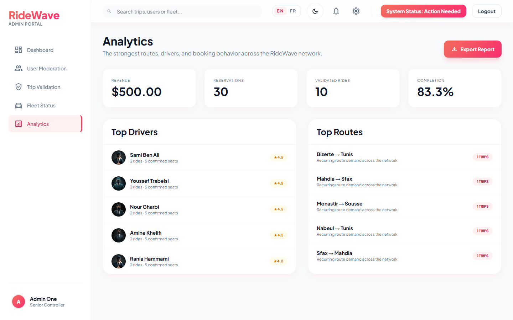

<div align="center">

[Features](https://github.com/smidamanar/RideWave#-features) · [Architecture](https://github.com/smidamanar/RideWave#%EF%B8%8F-architecture) · [Installation](https://github.com/smidamanar/RideWave#-installation) · [Preview](https://github.com/smidamanar/RideWave#-application-preview)

# 🚗 RideWave


### Full-Stack Carpooling Platform

</div>

RideWave is a web application built with Laravel, Blade and Tailwind CSS. Drivers register their vehicles and publish rides, passengers search for rides and request seats, and administrators supervise users, rides and the fleet from a dedicated back office. A token-secured JSON API (Laravel Sanctum) complements the web interface.

---

## ✨ Overview

RideWave follows the MVC architecture of Laravel, with a clear separation between routing, role-based middleware, controllers, Eloquent models, policies and Blade views.

```text
Browser / API client
   │
   │ HTTP
   ▼
Routes (web.php · api.php)
   │
   ▼
Middleware (auth, role, locale · auth:sanctum)
   │
   ▼
Controllers  ──►  Policies
   │
   ▼
Eloquent Models
   │
   ▼
Database (SQLite by default · MySQL / PostgreSQL supported)
```

---

## 🚀 Features

### 👤 Roles

RideWave has three levels of access, each with its own space:

| Role | Database value | Description |
|---|---|---|
| **Passenger** | `passager` | Searches rides, requests seats, reviews completed rides |
| **Driver** | `conducteur` | Manages vehicles, publishes rides, answers booking requests |
| **Admin** | `admin` | Oversees users, rides and fleet, with analytics and reporting |

#### Passenger
- Search rides by departure, destination, date and available seats
- Filter by price, time, vehicle type and amenities, and sort results
- Request seats on a ride
- Follow booking status and ride history
- Leave reviews and comment on rides
- Manage profile and profile photo

#### Driver
- Add, edit and delete vehicles with photos
- Publish rides, restricted to their own vehicles, with seat limits checked against vehicle capacity
- Set ride amenities: smoking, pets, baggage, food and drink, air conditioning
- Accept or decline booking requests from a dashboard
- Search rides, view history, review and comment

#### Admin
- Dashboard with platform statistics and analytics
- User, ride and fleet overviews
- Validate or unvalidate rides
- Global search and report export

#### Shared
- Database notifications (booking requested, booking decision, review, comment) with read and read-all actions
- Threaded comments with replies on every ride
- Light and dark theme, English and French interface

### 🔄 Booking Workflow

```text
Search Rides
      ↓
Choose a Ride
      ↓
Request Seats
      ↓
Driver Notified
      ↓
Driver Accepts / Declines
      ↓
Passenger Notified
      ↓
Ride History → Review
```

Reservation statuses: `en_attente` → `confirmee` / `refusee` / `annulee`.

### 🗃️ Domain Model

```text
User
 ├── Vehicules
 ├── Trajets (as driver)
 └── Reservations (as passenger)

Vehicule
 └── Trajets

Trajet
 ├── Driver (User)
 ├── Vehicule
 ├── Reservations
 └── Ride Comments

Reservation
 ├── Passenger (User)
 ├── Trajet
 └── Avis

Ride Comment
 ├── Trajet
 ├── User
 └── Replies (self-reference)
```

> Domain terms follow the French naming used in the code: `trajet` = ride, `vehicule` = vehicle, `avis` = review.

| Table | Content |
|---|---|
| `users` | Name, email, password, role, phone, profile photo, avatar style |
| `trajets` | Driver, route, date, time, price, seats, validation flag, vehicle, amenity flags |
| `vehicules` | Owner, make/model, registration, type, year, color, seats, photo |
| `reservations` | Passenger, ride, booking date, seats, status |
| `avis` | Reservation, rating, optional comment |
| `ride_comments` | Ride, author, body, optional parent comment |
| `notifications` | Laravel database notifications |

Database structure is managed with Laravel migrations, and demo data is created with factories and a seeder.

---

## ⚙️ Architecture

### Routes
Web routes are grouped by audience (`/passenger`, `/driver`, `/admin`) and protected by `auth` plus role middleware. Guest-only pages (login, register) use the `guest` middleware. API routes live under `/api`, with the main group protected by `auth:sanctum`. A `/up` health route is also registered.

### Middleware
A role middleware restricts each area to its role, and a locale middleware applies the user's language choice.

### Controllers
Controllers are organised by audience:

```text
Controllers/
├── Auth/        → login, registration, logout
├── Passenger/   → ride search, booking, history, profile
├── Driver/      → fleet, offer ride, dashboard, history, profile
├── Admin/       → dashboard, users, rides, fleet, analytics, reports
└── (shared)     → locale, notifications, ride comments
```

### Models & Policies
Eloquent models describe the entities and their relationships. Policies enforce ownership rules on vehicles and rides.

### Notifications
Four notification classes (`RideBookingRequested`, `RideBookingStatus`, `RideComment`, `RideReview`) are stored with Laravel's database channel.

### Views
Blade templates styled with Tailwind CSS, organised by role.

### Validation
Incoming data is validated in the controllers before it reaches the database, including seat counts against vehicle capacity and an allowlist for API sort fields.

---

## 🛠️ Technology Stack

| Technology | Purpose |
|---|---|
| PHP 8.2+ | Backend language |
| Laravel 12 | Application framework |
| Eloquent ORM | Database access |
| Laravel Sanctum 4 | API token authentication |
| SQLite (default) / MySQL / PostgreSQL | Database |
| Blade | Templating |
| Tailwind CSS 4 | Styling |
| Vite 7 + Axios | Asset bundling and HTTP client |
| PHPUnit 11 | Automated tests |
| Laravel Pint | Code formatting (PSR-12) |
| GitHub Actions | Continuous integration |

---

## 📂 Project Structure

```text
RideWave/
│
├── .github/workflows/ci.yml
├── .gitignore
├── LICENSE
├── README.md
│
└── RideWave/
    ├── app/
    │   ├── Http/
    │   │   ├── Controllers/
    │   │   │   ├── Admin/
    │   │   │   ├── Auth/
    │   │   │   ├── Driver/
    │   │   │   └── Passenger/
    │   │   └── Middleware/
    │   ├── Models/
    │   ├── Notifications/
    │   └── Policies/
    ├── bootstrap/
    ├── config/
    ├── database/
    │   ├── factories/
    │   ├── migrations/
    │   └── seeders/
    ├── docs/
    │   └── PAGES_GUIDE.md
    ├── lang/            (en, fr, ar)
    ├── public/
    ├── resources/
    │   ├── css/
    │   ├── js/
    │   └── views/
    ├── routes/
    ├── tests/
    │   ├── Feature/
    │   └── Unit/
    ├── composer.json
    ├── package.json
    └── vite.config.js
```

---

## 🚀 Installation

### Prerequisites

- PHP 8.2 or later (with `mbstring` and `pdo_sqlite`)
- Composer
- Node.js 20 or later and npm

### 1. Clone the repository

```bash
git clone https://github.com/smidamanar/RideWave.git
cd RideWave/RideWave
```

### 2. Install dependencies

```bash
composer install
npm install
```

### 3. Configure the environment

```bash
# Windows
copy .env.example .env

# Linux / macOS
cp .env.example .env

php artisan key:generate
```

RideWave uses **SQLite** by default, so no database server is needed. Create the database file:

```bash
# Windows (PowerShell)
New-Item -ItemType File database\database.sqlite

# Linux / macOS
touch database/database.sqlite
```

<details>
<summary><b>Using MySQL instead</b></summary>

Edit `.env`:

```env
DB_CONNECTION=mysql
DB_HOST=127.0.0.1
DB_PORT=3306
DB_DATABASE=ridewave
DB_USERNAME=root
DB_PASSWORD=
```

Then create an empty database named `ridewave`.
</details>

### 4. Create the tables and demo data

Optionally set a known password for the demo accounts in `.env` **before** seeding:

```env
DEMO_USER_PASSWORD=choose-a-strong-password
```

```bash
php artisan migrate --seed
```

The seeder creates 3 admins, 5 drivers, 10 passengers, 5 vehicles and 10 rides, with related reservations, reviews and comments. Demo emails use the `@ridewave.test` domain. If `DEMO_USER_PASSWORD` is left blank, a random password is generated and not printed.

> ⚠️ The seeder truncates its demo tables and refuses to run when `APP_ENV=production`. `migrate:fresh --seed` wipes the entire database; use it only on a disposable local database.

### 5. Run the application

```bash
npm run build
php artisan serve
```

Open <http://127.0.0.1:8000>.

For development with hot reload and all background processes at once:

```bash
composer run dev
```

This starts the PHP server, the queue listener, Laravel Pail and Vite together.

**One-command setup:** `composer run setup` installs dependencies, creates `.env`, generates the key, prepares SQLite, migrates and builds assets.

---

## 🔌 REST API

A JSON API is available under `/api`. Protected endpoints require a Sanctum bearer token.

```http
POST /api/register
Content-Type: application/json

{
  "name": "Example Passenger",
  "email": "passenger@example.test",
  "password": "secure-password",
  "role": "passager"
}
```

```http
GET /api/trajets/search?depart=Tunis&destination=Sousse
Authorization: Bearer <token>
Accept: application/json
```

| Method | Endpoint | Description |
|---|---|---|
| `POST` | `/api/register` | Create an account and receive a token |
| `POST` | `/api/login` | Log in and receive a token |
| `GET` | `/api/trajets/search` | Search rides (date, seats, price range, sorting) |
| `GET` `POST` | `/api/trajets` | List and create rides |
| `GET` `POST` | `/api/reservations` | List and create reservations |
| `DELETE` | `/api/reservations/{id}` | Cancel a reservation |
| `GET` `POST` | `/api/avis` | List and create reviews |
| `GET` `POST` `DELETE` | `/api/vehicules` | List, create and delete vehicles |

---

## 🧪 Testing

```bash
php artisan test
```

The suite contains 14 tests covering API authentication and security, web authentication and role redirects, ride search filtering, ride offering with seat limits, and the landing page.

To check code style with Laravel Pint:

```bash
./vendor/bin/pint --test
```

Every push and pull request runs the GitHub Actions workflow, which installs PHP 8.2 and Node 20, builds the assets, checks the code style and runs the tests.

---

## 🔒 Security

- Passwords are hashed with Laravel's hashing system
- CSRF protection on every web form
- Role-based middleware separates passenger, driver and admin areas
- Policies enforce ownership of vehicles and rides
- Sanctum token authentication on the API, with validated sort fields
- Server-side validation of submitted data
- Demo seeder is blocked in production and uses a random password unless configured
- Secrets are kept in `.env`, which is never committed

Before deploying publicly, set `APP_ENV=production`, `APP_DEBUG=false`, use a production database and serve the `RideWave/public` directory as the web root.

---

## 🚀 Future Improvements

- Complete the remaining API resource actions (`show`, `update`, `destroy`) and add a logout / token-revocation endpoint
- Enable Arabic in the language switcher (translation files already exist)
- Load the Vite-compiled assets in the Blade layouts instead of the Tailwind CDN
- Email notifications for booking requests and decisions
- Interactive map and dynamic location search
- Online payments
- Docker Compose environment
- OpenAPI documentation for the API

---

## 📸 Application Preview

### Public Site

| Landing Page | Login |
|---|---|
|  |  |

### Passenger

| Find Rides | Booking History |
|---|---|
|  |  |

### Driver

| Offer a Ride | Fleet Management |
|---|---|
|  |  |

### Administration

| Dashboard | Analytics |
|---|---|
|  |  |

---

## 🎯 Concepts Demonstrated

- MVC architecture with Laravel
- Role-based access control with middleware and policies
- Eloquent relationships (one-to-many, many-to-one, self-referencing)
- Database migrations, factories and seeders
- Session authentication and token-based API authentication (Sanctum)
- Database notifications
- File uploads (profile and vehicle photos)
- Multi-language support (English / French)
- Blade templating and Tailwind CSS
- Automated testing with PHPUnit and CI with GitHub Actions

---

## 📄 License

This project is licensed under the MIT License. See [LICENSE](LICENSE) for details.

---

## 👩‍💻 Author

**Manar SMIDA**

Software Engineering Student 
Full-Stack Development • Laravel • PHP

[GitHub](https://github.com/smidamanar)
